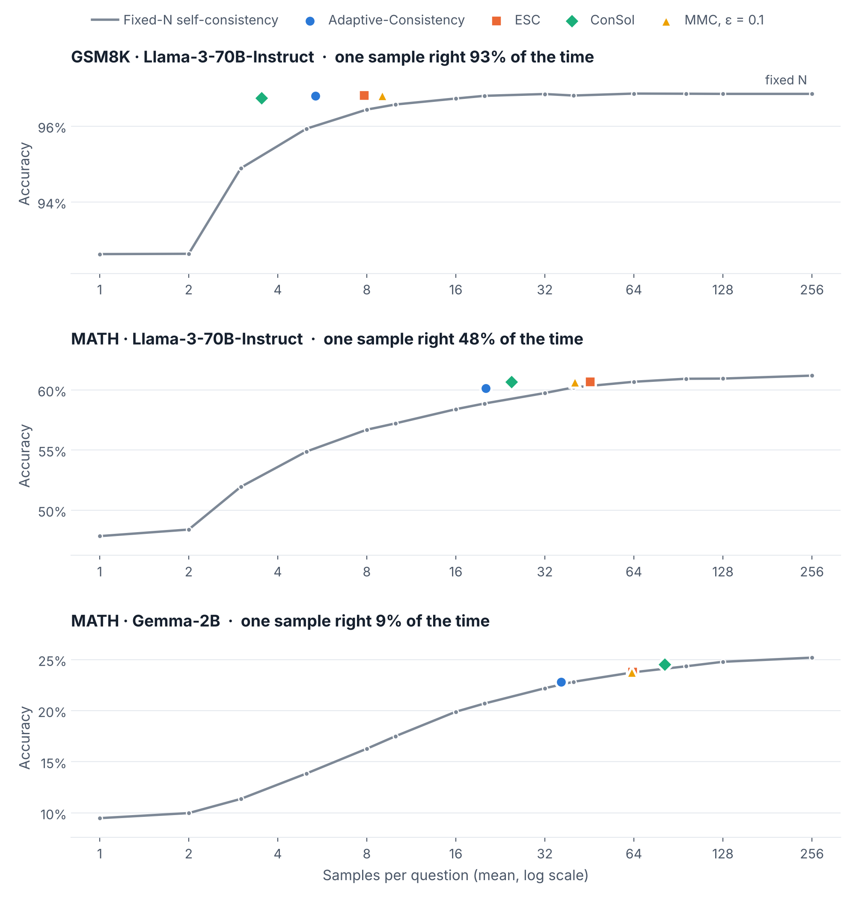
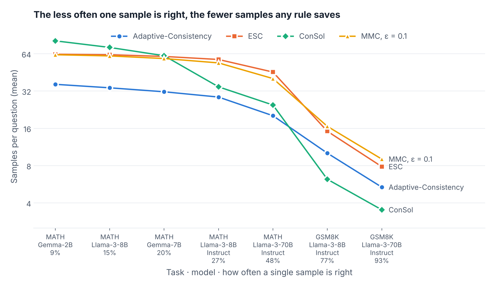

<div align="center">

# Self-Consistency Stopping

**How many samples are enough?**

Early-stopping rules for LLM majority voting, implemented once and compared on the same
recorded samples, across models that are right 9% to 93% of the time.

[](https://github.com/EllenSyuu/self-consistency-stopping/actions/workflows/ci.yml)

[](LICENSE)

[Why](#why) · [Findings](#findings) · [Results](#results) · [Rules](#the-rules) · [Reproduce](#reproduce) · [Use the rules](#use-the-rules) · [Limits](#limits)

</div>

<picture>
  <source media="(prefers-color-scheme: dark)" srcset="docs/img/frontiers-dark.png">
  
</picture>

## Why

Self-consistency samples a model N times and returns the most frequent answer. N is
usually fixed (40 or 64), although most questions are settled after a few samples. A
dozen rules now stop sampling early, some by heuristic and some with a statistical
guarantee, and each paper compares itself with two or three others on its own models,
datasets and budgets. Which rule to use, and when early stopping is worth anything,
is not settled.

This repository implements the rules once, from their papers' definitions, and replays
them on the **same recorded samples**: 10,000 sampled solutions per problem from the
[Large Language Monkeys](https://arxiv.org/abs/2407.21787) release, for seven
model–task settings. Every rule sees the same random sample orders, so differences are
due to the rules, not to sampling luck.

## Findings

1. **When one sample is usually right, every rule pays off.** On GSM8K (one sample right
   77% and 93% of the time) all four rules match fixed-40 self-consistency to within
   0.1 point while using 3.5 to 16.6 samples per question instead of 40.
2. **When one sample is usually wrong, almost none of the saving remains.** On MATH
   (9% to 48%) the vote rarely settles: ESC and MMC use most of their 64-sample budget,
   and every rule lands on or a little above the fixed-N curve at the same cost.
   Adaptive-Consistency spends the least there, partly because its budget is 40 rather
   than 64, and matches fixed N = 40.
3. **Guarantees differ in what they deliver.** MMC's certificate held: when it stopped,
   its answer was the model's most frequent answer in all but at most 0.2% of runs,
   against a promised 10%. It pays by rarely stopping on hard settings (3% to 47% of
   runs). ConSol, configured with α = 0.05, stops in 91% to 100% of runs, but on MATH
   13% to 27% of those stops return an answer that is not the model's most frequent one;
   its stopping test reduces in practice to a three-vote lead.

<picture>
  <source media="(prefers-color-scheme: dark)" srcset="docs/img/cost_by_strength-dark.png">
  
</picture>

<picture>
  <source media="(prefers-color-scheme: dark)" srcset="docs/img/guarantee_audit-dark.png">
  
</picture>

<sub>"The model's most frequent answer" is the mode of all 10,000 recorded samples for
the problem, the quantity MMC certifies. It is a different target from the correct
answer: a model can be consistently wrong.</sub>

## Results

| Setting | One sample | Fixed N = 40 | Adaptive-Consistency | ESC | ConSol | MMC (ε = 0.1) |
|---|---|---|---|---|---|---|
| GSM8K · Llama-3-70B-Instruct | 93.0% | 96.8% · 40 | 96.8% · 5.4 | 96.8% · 7.9 | 96.7% · 3.5 | 96.8% · 9.0 |
| GSM8K · Llama-3-8B-Instruct | 76.8% | 87.0% · 40 | 86.9% · 10.1 | 86.9% · 15.2 | 87.0% · 6.2 | 87.0% · 16.6 |
| MATH · Llama-3-70B-Instruct | 47.9% | 60.2% · 40 | 60.1% · 20.2 | 60.7% · 45.6 | 60.7% · 24.7 | 60.7% · 40.4 |
| MATH · Llama-3-8B-Instruct | 26.8% | 42.2% · 40 | 42.2% · 28.6 | 42.8% · 57.6 | 43.0% · 34.6 | 42.8% · 54.0 |
| MATH · Gemma-7B | 20.2% | 39.9% · 40 | 39.9% · 31.6 | 41.5% · 60.9 | 42.2% · 61.8 | 41.5% · 58.6 |
| MATH · Llama-3-8B | 14.7% | 32.1% · 40 | 32.0% · 34.0 | 33.2% · 62.9 | 33.9% · 72.0 | 33.2% · 61.5 |
| MATH · Gemma-2B | 9.3% | 22.8% · 40 | 22.8% · 36.3 | 23.8% · 63.5 | 24.5% · 81.4 | 23.8% · 62.9 |

Each cell: accuracy · mean samples per question, averaged over the problems (127 for
GSM8K, 128 for MATH) and 200 random sample orders per problem. Budgets follow each
paper: 40 for Adaptive-Consistency; 40 (GSM8K) or 64 (MATH) for ESC and MMC; 256 for
ConSol. Compare a rule with fixed N at the same cost on the frontier figure, not only
with the N = 40 column. Every number, including fixed N from 1 to 256 and MMC at
ε = 0.05, is in [`results/summary.json`](results/summary.json).

## The rules

| Rule | Source | Stops when | Settings used |
|---|---|---|---|
| Fixed N | Wang et al., ICLR 2023 | after N samples | N = 1 … 256 |
| Adaptive-Consistency | Aggarwal et al., EMNLP 2023 | Beta(v₁+1, v₂+1) puts > 0.95 on p₁ > p₂ (top two counts) | threshold 0.95, budget 40 |
| ESC | Li et al., ICLR 2024 | a window of w samples is unanimous | w = 5, L = 40 (GSM8K); w = 8, L = 64 (MATH) |
| ConSol | Lee et al., 2025 | SPRT of p = ½ against p = 0.5001 on the top two counts crosses a boundary; samples drawn in batches | the authors' `consol` 0.3.0 defaults: α = 0.05, budget 256; SPRT and mSPRT |
| MMC | Cordero-Encinar & Duncan, 2025 | two e-processes (leader vs runner-up, leader vs the rest) both reach 1/ε | truncated Beta(½, ½) mixture, ε = 0.1 and 0.05, budget 40 or 64 |

Each rule is a few dozen lines in [`src/scstop/rules.py`](src/scstop/rules.py), with
its paper's definition in the docstring, and is tested against that definition in
[`tests/test_rules.py`](tests/test_rules.py) (including a simulation that MMC's
type-I error stays below ε when the top two answers tie). Conventions shared by all
rules, so that none gains from bookkeeping:

* A sample with no extractable answer costs one call and casts no vote.
* Ties go to the answer that reached the tied count first.
* ConSol's package draws batches and discards unparsable outputs before counting; here
  they count as spent calls like everywhere else, and its final answer uses the shared
  tie-break rather than pandas' `mode()`.

**Not included yet.** CITE (Ota et al., 2026) certifies a target answer fixed before
sampling, so it is not a drop-in rule for majority voting. BARS (2026) adds refusal and
budget logic and is next on the list.

## Reproduce

```bash
pip install -e ".[bench,test]"
pytest -q                                              # 26 tests, about 2 s
python scripts/prepare_monkey_business.py --out data   # downloads about 4.3 GB, writes compact labels
python scripts/run_benchmark.py --data data --out results --replicates 200   # about 8 minutes on 2 cores
python scripts/make_figures.py && python scripts/make_table.py
```

`prepare_monkey_business.py` turns each sample into an answer label: all samples the
dataset marks correct form one class (the authors' grader judged each equivalent to
the reference answer), wrong answers are grouped by a light string normalisation, and
samples without a final answer are marked as abstaining. The raw samples are not
stored in this repository.

## Use the rules

```python
import numpy as np
from scstop import MartingaleMajorityCertificate

rule = MartingaleMajorityCertificate(epsilon=0.1, budget=40)
answers = []                                  # answer ids in sampling order, -1 for "no answer"
while True:
    answers.append(ask_model_and_parse())     # your sampling call
    decision = rule.run(np.array(answers))
    if decision.status != "need_more":
        break
decision.answer, decision.samples, decision.status   # e.g. (3, 6, "stopped"), or "abstained" at the budget
```

A rule looks only at the samples it has been given and returns `need_more` until it
stops or spends its budget, so the same object works online as above and offline on a
recorded stream, with the same decision either way (tested).

## Limits

* **Recorded samples, not fresh ones.** Each run draws without replacement from 10,000
  samples per problem, which is close to, but not the same as, sampling the model anew.
* **Two tasks, seven settings, older models.** GSM8K and MATH with Llama-3 and Gemma.
  Stronger reasoning models with long chains of thought are not covered.
* **Answer grouping.** Wrong answers are grouped by string normalisation, so two wrong
  answers that are mathematically equal but written differently vote separately.
* **Sample counts, not tokens.** Costs are in samples; a rule that stops early on
  short answers saves fewer tokens than its sample count suggests.

## Data and licence

Samples: [ScalingIntelligence/monkey_business](https://huggingface.co/datasets/ScalingIntelligence/monkey_business)
(MIT), from Brown et al., *Large Language Monkeys: Scaling Inference Compute with
Repeated Sampling* (2024). Code: MIT, see [LICENSE](LICENSE). To cite this repository,
see [CITATION.cff](CITATION.cff).
