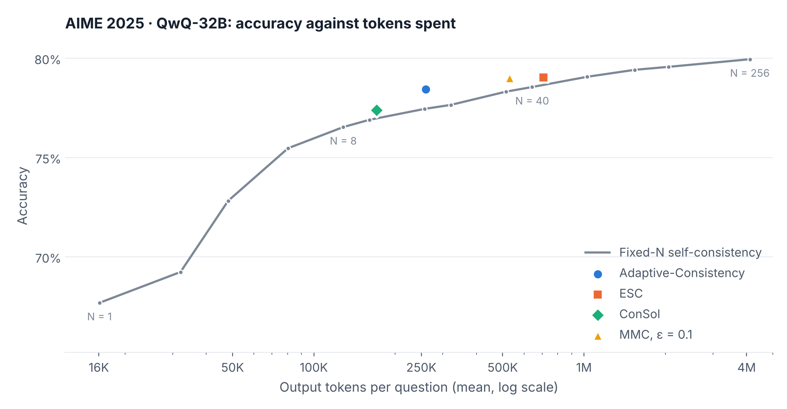
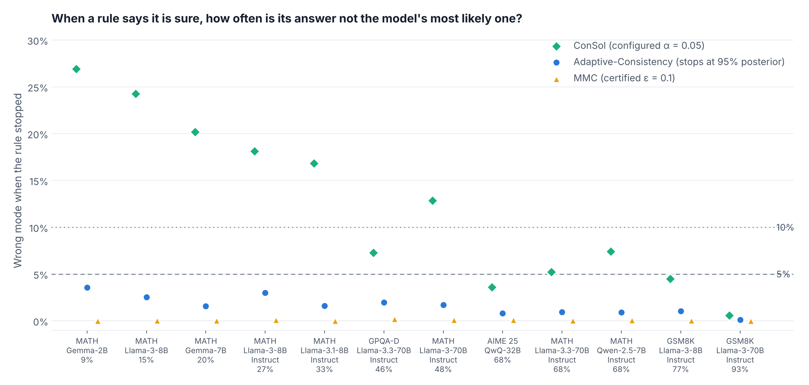

<div align="center">

# Self-Consistency Stopping

**How many samples are enough?**

Early-stopping rules for LLM majority voting, implemented once and compared on the same
recorded samples: 12 model–task settings, from a reasoning model on AIME 2025 to small
base models on MATH, right 9% to 93% of the time on a single sample.

[](https://github.com/EllenSyuu/self-consistency-stopping/actions/workflows/ci.yml)

[](LICENSE)

[Why](#why) · [Findings](#findings) · [Results](#results) · [Rules](#the-rules) · [Reproduce](#reproduce) · [Use the rules](#use-the-rules) · [Limits](#limits)

</div>

<picture>
  <source media="(prefers-color-scheme: dark)" srcset="docs/img/frontiers-dark.png">
  
</picture>

## Why

Self-consistency samples a model N times and returns the most frequent answer. N is
usually fixed (40 or 64), although most questions are settled after a few samples. A
dozen rules now stop sampling early, some by heuristic and some with a statistical
guarantee, and each paper compares itself with two or three others on its own models,
datasets and budgets. Which rule to use, and when early stopping is worth anything,
is not settled.

This repository implements the rules once, from their papers and the authors' code, and
replays them on the **same recorded samples**: 256 to 10,000 sampled solutions per
problem from two public releases. Every rule sees the same random sample orders, so
differences come from the rules, not from sampling luck.

## Findings

1. **One rule is safe everywhere.** Adaptive-Consistency matches fixed-40
   self-consistency to within 0.1 point in all 12 settings, using 5.4 to 36.3 samples per
   question instead of 40.
2. **On a reasoning model the saving is large in tokens.** QwQ-32B writes about 16,000
   tokens per AIME 2025 attempt. Adaptive-Consistency reaches the accuracy of fixed
   N = 40 (78.4% against 78.5%) with 260K output tokens per question instead of 643K,
   60% fewer.
3. **What limits the saving is how spread out the answers are.** On the six MATH
   settings where one sample is right less than half the time, answers scatter, the vote
   rarely settles, and ESC and MMC use 40 to 64 of their 64 samples; at equal cost every
   rule is within about 2 points of the fixed-N curve. GPQA-Diamond shows the other
   side: Llama-3.3-70B is right only 46% of the time but usually picks the same letter,
   so Adaptive-Consistency, ConSol and MMC stop early (5.7 to 25.8 samples; ESC, which
   waits for eight identical answers in a row, still uses 37.8), and voting barely helps at all
   (45.7% for one sample, 48.2% for 40).
4. **Check what a rule actually promises.** MMC is the only rule here that certifies
   its answer. When it stopped, its answer differed from the model's most frequent
   answer in at most 0.2% of runs, against a 10% target; it pays by stopping in only 3%
   to 48% of runs on the hardest settings. ConSol states no such guarantee: with its
   default parameters its test is exactly "stop when the leader is three votes ahead",
   so it stops in 91% to 100% of runs, and on problems whose two leading answers are
   close it often returns the runner-up (0.6% to 26.9% of stops, rising as the task
   gets harder).

<picture>
  <source media="(prefers-color-scheme: dark)" srcset="docs/img/tokens_qwq-dark.png">
  
</picture>

<picture>
  <source media="(prefers-color-scheme: dark)" srcset="docs/img/guarantee_audit-dark.png">
  
</picture>

<sub>"The model's most frequent answer" is the mode of all recorded samples for the
problem, the quantity MMC certifies. It is not the correct answer: a model can be
consistently wrong.</sub>

<picture>
  <source media="(prefers-color-scheme: dark)" srcset="docs/img/cost_by_strength-dark.png">
  
</picture>

## Results

| Setting | One sample | Fixed N = 40 | Adaptive-Consistency | ESC | ConSol | MMC (ε = 0.1) |
|---|---|---|---|---|---|---|
| GSM8K · Llama-3-70B-Instruct | 93.0% | 96.8% · 40 | 96.8% · 5.4 | 96.8% · 7.9 | 96.7% · 3.5 | 96.8% · 9.1 |
| GSM8K · Llama-3-8B-Instruct | 76.8% | 87.0% · 40 | 86.9% · 10.1 | 86.9% · 15.2 | 87.0% · 6.2 | 87.0% · 16.3 |
| MATH · Qwen-2.5-7B-Instruct | 68.5% | 78.7% · 40 | 78.7% · 13.4 | 79.3% · 33.0 | 79.0% · 11.6 | 79.3% · 26.0 |
| MATH · Llama-3.3-70B-Instruct | 68.0% | 78.5% · 40 | 78.4% · 12.8 | 78.7% · 32.1 | 78.0% · 10.8 | 78.7% · 25.3 |
| AIME 2025 · QwQ-32B | 67.8% | 78.5% · 40 | 78.4% · 12.5 | 79.0% · 35.2 | 77.4% · 7.9 | 79.0% · 25.5 |
| MATH · Llama-3-70B-Instruct | 47.9% | 60.2% · 40 | 60.1% · 20.2 | 60.7% · 45.6 | 60.7% · 24.7 | 60.7% · 39.8 |
| GPQA-Diamond · Llama-3.3-70B-Instruct | 45.7% | 48.2% · 40 | 48.2% · 12.0 | 48.1% · 37.8 | 48.3% · 5.7 | 48.0% · 25.8 |
| MATH · Llama-3.1-8B-Instruct | 33.1% | 52.9% · 40 | 52.9% · 26.8 | 54.4% · 54.2 | 55.3% · 44.5 | 54.4% · 50.1 |
| MATH · Llama-3-8B-Instruct | 26.8% | 42.2% · 40 | 42.2% · 28.6 | 42.8% · 57.6 | 43.0% · 34.6 | 42.8% · 53.6 |
| MATH · Gemma-7B | 20.2% | 39.9% · 40 | 39.9% · 31.6 | 41.5% · 60.9 | 42.2% · 61.8 | 41.5% · 58.1 |
| MATH · Llama-3-8B | 14.7% | 32.1% · 40 | 32.0% · 34.0 | 33.2% · 62.9 | 33.9% · 72.0 | 33.2% · 61.2 |
| MATH · Gemma-2B | 9.3% | 22.8% · 40 | 22.8% · 36.3 | 23.8% · 63.5 | 24.5% · 81.4 | 23.8% · 62.8 |

Each cell: accuracy · mean samples per question, over all problems and 200 random sample
orders per problem. Budgets follow each paper: 40 for Adaptive-Consistency; 40 (GSM8K)
or 64 (all other tasks) for ESC and MMC; 256 for ConSol. Compare a rule with fixed N
at the same cost on the frontier figure, not only with the N = 40 column.

**Tokens on AIME 2025 with QwQ-32B** (30 problems, 512 recorded samples each):

| Rule | Accuracy | Samples | Output tokens per question | vs fixed N = 40 |
|---|---|---|---|---|
| Fixed N = 40 | 78.5% | 40.0 | 643K | — |
| Fixed N = 64 | 79.1% | 64.0 | 1,029K | +60% |
| Adaptive-Consistency | 78.4% | 12.5 | 260K | −60% |
| ESC | 79.0% | 35.2 | 707K | +10% |
| ConSol | 77.4% | 7.9 | 171K | −73% |
| MMC (ε = 0.1) | 79.0% | 25.5 | 530K | −18% |

With 30 problems, each accuracy carries a 95% interval about ±14 points wide
(resampling problems). The rules are compared on identical sample orders, so their
differences are far more precise than the intervals of each rule alone. Every number,
its interval, fixed N from 1 to 256 and MMC at ε = 0.05 are in
[`results/summary.json`](results/summary.json).

## The rules

| Rule | Source | Stops when | Settings used |
|---|---|---|---|
| Fixed N | Wang et al., ICLR 2023 | after N samples | N = 1 … 256 |
| Adaptive-Consistency | Aggarwal et al., EMNLP 2023 | Beta(v₁+1, v₂+1) puts > 0.95 on p₁ > p₂ (top two counts) | threshold 0.95, budget 40 |
| ESC | Li et al., ICLR 2024 | a window of w samples is unanimous | w = 5, L = 40 (GSM8K); w = 8, L = 64 (MATH, as in the paper; AIME and GPQA use the MATH setting, our choice) |
| ConSol | Lee et al., 2025 | SPRT of p = ½ against p = 0.5001 on the top two counts crosses a boundary; samples drawn in batches | the authors' `consol` 0.3.0 defaults: α = 0.05, budget 256; SPRT and mSPRT |
| MMC | Cordero-Encinar & Duncan, 2025 | two e-processes (leader vs runner-up, leader vs the rest) both reach 1/ε | truncated Beta(½, ½) mixture, ε = 0.1 and 0.05, budget 40 or 64 |

Each rule is a few dozen lines in [`src/scstop/rules.py`](src/scstop/rules.py), with
its paper's definition in the docstring, and is tested against that definition in
[`tests/test_rules.py`](tests/test_rules.py), including a simulation showing MMC's
type-I error stays below ε when the top two answers tie. Conventions shared by all
rules, so that none gains from bookkeeping:

* A sample with no extractable answer costs one call and casts no vote.
* Ties go to the answer that reached the tied count first.
* ConSol's package discards unparsable outputs before counting; here they count as spent
  calls like everywhere else, and its final answer uses the shared tie-break rather than
  pandas' `mode()`.

**Not included.** CITE (Ota et al., 2026) certifies a target answer fixed before
sampling, so it is not a drop-in rule for majority voting. BARS (2026) is published
with GPL-3.0 reference code, which cannot be adapted into this MIT repository, and its
paper leaves the window-choosing program underspecified, so an independent
implementation could not be shown to be faithful.

## Reproduce

```bash
pip install -e ".[bench,test]"
pytest -q                                                  # 34 tests, about 5 s
python scripts/prepare_monkey_business.py --out data       # 7 settings, downloads about 4.3 GB
python scripts/prepare_sc_genrm.py --out data              # 5 settings, about 0.55 GB, grades with math-verify
python scripts/run_benchmark.py --data data --out results --replicates 200   # about 11 minutes on 2 cores
python scripts/make_figures.py && python scripts/make_table.py
```

How samples become answer labels:

* **Large Language Monkeys** comes with a correctness flag per sample: all samples
  marked correct form one class, wrong answers are grouped by a light string
  normalisation.
* **sc-genrm-scaling** comes without flags, so the script grades: the last `\boxed{}`
  as an integer for AIME, the letter after "The final answer is" for GPQA, and
  [math-verify](https://github.com/huggingface/Math-Verify) against the reference's
  last `\boxed{}` for MATH (13 of the comparisons timed out and count as wrong). Token
  counts for QwQ-32B use its own tokenizer.

Samples without a final answer (for QwQ-32B, those cut off at its 32,768-token limit)
are marked as abstaining. No raw samples are stored in this repository.

## Use the rules

```python
import numpy as np
from scstop import MartingaleMajorityCertificate

rule = MartingaleMajorityCertificate(epsilon=0.1, budget=40)
answers = []                                  # answer ids in sampling order, -1 for "no answer"
while True:
    answers.append(ask_model_and_parse())     # your sampling call
    decision = rule.run(np.array(answers))
    if decision.status != "need_more":
        break
decision.answer, decision.samples, decision.status   # e.g. (3, 6, "stopped"), or "abstained" at the budget
```

A rule looks only at the samples it has been given and returns `need_more` until it
stops or spends its budget, so the same object works online as above and offline on a
recorded stream, with the same decision either way (tested).

## Limits

* **Recorded samples, not fresh ones.** Each run draws without replacement from 256 to
  10,000 samples per problem. With 256 (GPQA, MATH with Llama-3.3-70B) the largest
  budgets reuse most of the pool, so the highest fixed-N points there are closer to
  "vote over everything recorded" than to fresh sampling.
* **One reasoning model.** QwQ-32B on AIME 2025 (30 problems) is the only long
  chain-of-thought setting; the others are instruction-tuned or base models on GSM8K,
  MATH and GPQA-Diamond.
* **Answer grouping uses the grader for correct answers.** All samples the grader
  accepts form one class, which a live system could not know; wrong answers are grouped
  by string normalisation only. With classes built from the normalised string alone, on
  the two MATH settings checked so far every rule loses 0.5 to 1.6 accuracy points and
  needs 4% to 28% more samples, so the table is an upper bound. `prepare_sc_genrm.py`
  now also writes these grader-free classes; a full rerun on them is planned.
* **"Matches fixed N = 40" is a point estimate.** Intervals for differences between
  rules, and a non-inferiority test, are not reported yet.
* **Costs are output samples or tokens.** Prompt tokens and wall-clock latency are not
  modelled; parallel sampling would make an adaptive rule's latency cost larger than its
  token cost suggests.

## Corrections

* **ESC on AIME 2025 and GPQA-Diamond.** The first release ran ESC with a window of 5 on
  these two settings instead of the documented 8. Corrected: AIME 79.0% with 35.2
  samples and 707K tokens (was 78.5%, 25.1, 536K); GPQA 48.1% with 37.8 samples (was
  48.2%, 22.4).
* **MMC.** The first vote for a non-leading answer was not charged to the
  leader-versus-runner-up process. Fixed; table entries move by at most 0.1 point and
  1.3 samples.
* **ConSol.** An earlier version of finding 4 read as if ConSol broke a guarantee. It
  states none; the finding now says so.

## Data and licence

* Samples, Large Language Monkeys:
  [ScalingIntelligence/monkey_business](https://huggingface.co/datasets/ScalingIntelligence/monkey_business)
  (MIT), Brown et al., *Large Language Monkeys: Scaling Inference Compute with Repeated
  Sampling* (2024).
* Samples, QwQ-32B, GPQA-Diamond and MATH128: [sc-genrm-scaling](https://huggingface.co/sc-genrm-scaling)
  (Apache-2.0), Singhi et al., *When To Solve, When To Verify: Compute-Optimal Problem
  Solving and Generative Verification for LLM Reasoning* (COLM 2025).
* Code: MIT, see [LICENSE](LICENSE). To cite this repository, see [CITATION.cff](CITATION.cff).
